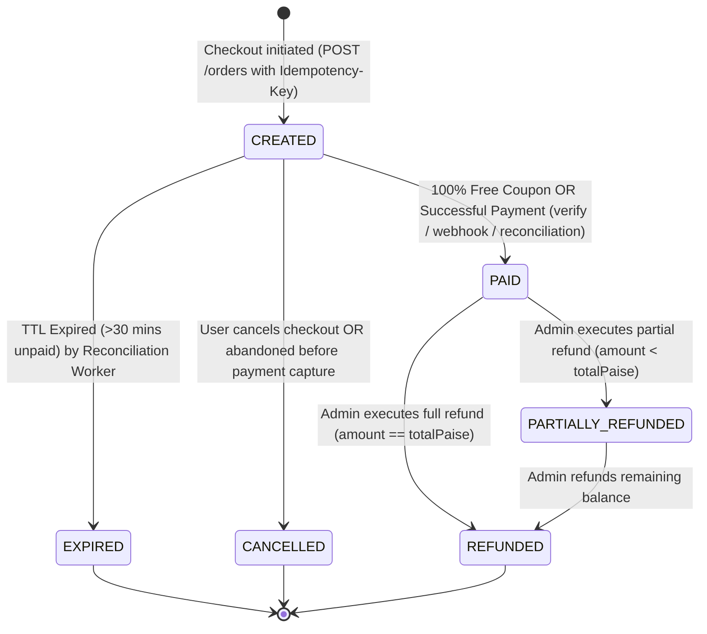
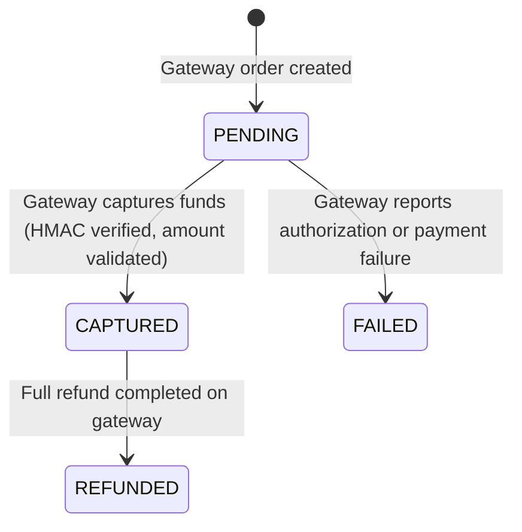
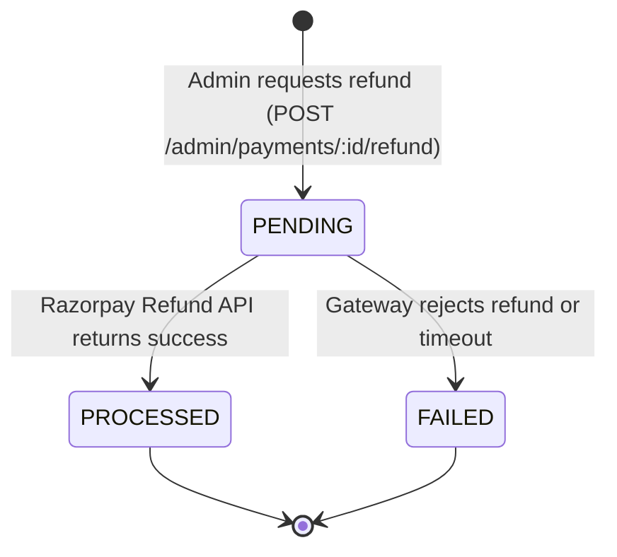
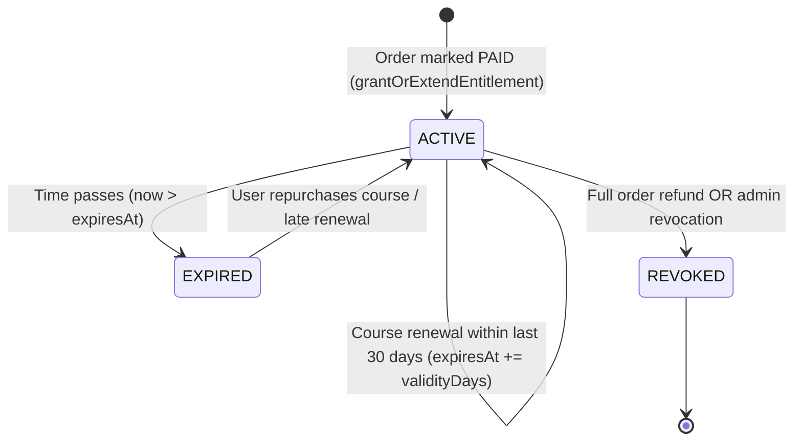

# Payments, Orders, Entitlements & Invoicing Architecture

This document details the financial state machines, transaction semantics, pricing computations, tax logic, and security rules governing Phase 4.

---

## 1. State Machine Specifications

### 1.1 Order State Machine



#### Order Transitions

| From                 | To                   | Trigger / Guard                                            | Business Effect                                                            |
| :------------------- | :------------------- | :--------------------------------------------------------- | :------------------------------------------------------------------------- |
| `[*]`                | `CREATED`            | `POST /orders` with verified email + idempotency key       | Order reserved in DB; Razorpay gateway order created.                      |
| `CREATED`            | `PAID`               | `markOrderPaid()` (signature valid, amount/currency match) | Grants or extends `Entitlement`; locks and generates sequential `Invoice`. |
| `CREATED`            | `EXPIRED`            | Scheduled BullMQ reconciliation (>30 mins without payment) | Order marked expired; releases coupon allocation.                          |
| `PAID`               | `PARTIALLY_REFUNDED` | Admin refund API (confirmed by Razorpay API)               | Audit logged; entitlement remains `ACTIVE`.                                |
| `PAID`               | `REFUNDED`           | Admin full refund API (confirmed by Razorpay API)          | Audit logged; entitlement transitioned to `REVOKED`.                       |
| `PARTIALLY_REFUNDED` | `REFUNDED`           | Admin refunds remaining balance to total                   | Entitlement transitioned to `REVOKED`.                                     |

---

### 1.2 Payment State Machine



#### Payment Transitions

| From       | To         | Guard                                                                             |
| :--------- | :--------- | :-------------------------------------------------------------------------------- |
| `PENDING`  | `CAPTURED` | Valid Razorpay signature + authoritative gateway status `captured` / `authorized` |
| `PENDING`  | `FAILED`   | Gateway failure event / error callback                                            |
| `CAPTURED` | `REFUNDED` | Sum of successful refunds equals payment `amountPaise`                            |

---

### 1.3 Refund State Machine



---

### 1.4 Entitlement State Machine



#### Renewal Calculation Rule:

```ts
const baseDate = currentExpiry && currentExpiry > now ? currentExpiry : now;
newExpiresAt = new Date(baseDate.getTime() + validityDays * 86400 * 1000);
```

---

## 2. Integer Paise & Currency Safety Rules

1. **Integer Arithmetic Only:** All financial amounts are stored, validated, and processed strictly in integer **paise** (1 INR = 100 paise). Floating-point currencies are strictly prohibited.
2. **Authoritative Server Computations:** The client never passes price, subtotal, discount, or tax. The API fetches the product and coupon records directly from the database under row locks:
   $$\text{subtotalPaise} = \text{product.pricePaise}$$
   $$\text{discountPaise} = \text{calculated from Coupon}$$
   $$\text{taxableBase} = \text{subtotalPaise} - \text{discountPaise}$$
3. **Tax Inclusive / Exclusive Calculation:**
   - Configuration read dynamically from `AppSetting` (`tax_config` and `business_profile`).
   - If `pricesTaxInclusive = true`:
     $$\text{taxPaise} = \text{round}\left(\text{taxableBase} - \frac{\text{taxableBase}}{1 + \frac{\text{gstRatePercent}}{100}}\right)$$
     $$\text{totalPaise} = \text{taxableBase}$$
   - If `pricesTaxInclusive = false`:
     $$\text{taxPaise} = \text{round}\left(\text{taxableBase} \times \frac{\text{gstRatePercent}}{100}\right)$$
     $$\text{totalPaise} = \text{taxableBase} + \text{taxPaise}$$
   - Rounding uses half-up integer rounding: `Math.round()`.
   - If `gstin` is unset or `gstRatePercent = 0`, `taxPaise = 0` and no tax lines are displayed on invoices.

---

## 3. Idempotent Order Creation & Payment Confirmation

### 3.1 Order Creation (`POST /orders`)

- Requires `Idempotency-Key` HTTP header.
- Cached in DB: `Order.idempotencyKey` has a unique constraint.
- **Replay:** An identical request with the same idempotency key returns the existing order with HTTP 200 and `{ isReplay: true }`.
- **Conflict:** A request using a previously used idempotency key with different payload parameters (e.g. different `productId` or `couponCode`) is rejected with **HTTP 409 Conflict**.

### 3.2 Single Idempotent `markOrderPaid()`

All three payment confirmation pathways delegate to a single core function `markOrderPaid()`:

1. Browser client verify callback (`POST /api/v1/payments/verify`)
2. Razorpay webhook endpoint (`POST /api/v1/webhooks/razorpay`)
3. Scheduled reconciliation worker (`orderService.reconcileStuckOrders()`)

#### Concurrency & Double-Grant Guarantees:

- Runs in a single atomic PostgreSQL transaction.
- **Row Locking:** Acquires `SELECT id FROM "Order" WHERE id = ... FOR UPDATE` before evaluating state.
- If `order.status === 'PAID'`, it immediately returns the existing `order`, `entitlement`, and `invoice` with `alreadyPaid: true` and exits.
- Validates that Razorpay payment status is `captured` or `authorized`.
- Validates that Razorpay payment `amountPaise === order.totalPaise`.
- Validates currency match (`INR`).
- Generates gap-free sequential invoice numbers using `SELECT "currentSequence" FROM "AppSetting" WHERE key = 'invoice_config' FOR UPDATE`.
- Inserts `Payment`, updates `Order`, creates `Invoice`, and grants/extends `Entitlement` atomically.

---

## 4. Sequential Invoice Numbering

- Format: `INV/{YY}-{YY}/{00000}` (e.g. `INV/26-27/00001` <= 16 characters).
- Financial Year resets every April 1st:
  - If month is Jan-Mar (months 0-2): FY is `(year - 1)-(year)`
  - If month is Apr-Dec (months 3-11): FY is `(year)-(year + 1)`
- Guaranteed zero gaps and unique under high concurrency via row locking `AppSetting`.

---

## 5. Razorpay Auto-Capture Requirement & 15-Minute Authorized Alerting

> [!IMPORTANT]
> **Auto-Capture Clarification:** Razorpay **does NOT** automatically emit `payment.captured` unless **Auto-Capture** is explicitly enabled. If auto-capture is disabled on your Razorpay merchant account, payments will transition to `authorized` and remain there until captured manually or voided after the authorization window.
>
> 1. **Merchant Setting:** You must enable Auto-Capture in the Razorpay Dashboard under **Settings $\rightarrow$ Payment Capture $\rightarrow$ Automatically capture all payments**.
> 2. **Order Creation Directive:** When creating orders via the Razorpay API, our backend also explicitly sets `payment_capture: 1` as a belt-and-suspenders measure.
> 3. **Critical Alert Monitoring:** Payments sitting in the `authorized` (or `PENDING`) state for **more than 15 minutes** trigger an error-level alert (`CRITICAL ALERT`) in the reconciliation worker (`orderService.reconcileStuckOrders`), alerting the engineering and operations team to either enable auto-capture or manually capture the transaction.

---

## 6. Webhook Processing Architecture, Deduplication, & Sweeper Job

1. **Insert-First Deduplication:** Webhooks are ingested by inserting the `WebhookEvent` row first. Any concurrent or duplicate webhook delivery violates the unique constraint on `providerEventId` (Prisma error `P2002`) and returns **HTTP 200** idempotently without re-processing.
2. **Fast Return & BullMQ Offload:** The HTTP handler returns **HTTP 200** within milliseconds and delegates heavy processing to the `razorpay-webhooks` BullMQ queue.
3. **Queue Failure Resilience:** If inserting the event succeeds but enqueueing to BullMQ fails (e.g. Redis connection timeout), the HTTP handler returns **HTTP 500** so Razorpay schedules an exponential retry.
4. **Stuck Event Sweeper:** The background reconciliation worker runs `sweepStuckWebhookEvents()`, which queries for any `WebhookEvent` rows in `PENDING` status for more than 5 minutes and automatically re-enqueues them.
5. **Strict Field Validation:** The webhook processing path validates `orderId`, payment `amount` in integer paise, and `currency` (`INR`) against the database order before calling `markOrderPaid`. Mismatches immediately mark the `WebhookEvent` as `FAILED` and reject fulfillment.
